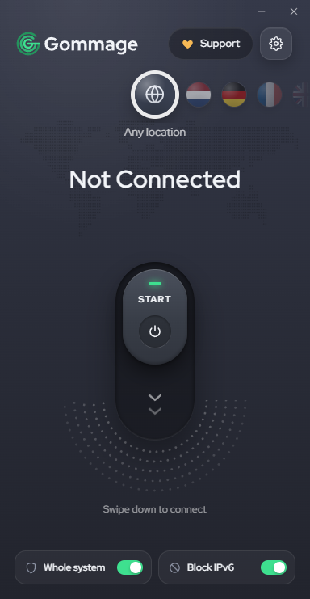

<h1 align="center">
  <picture>
    <source media="(prefers-color-scheme: dark)" srcset="assets/logo/gommage-wordmark-dark.svg">
    
  </picture>
</h1>

<p align="center">A one-tap Tor client for Windows, Linux and Android (phones and TVs), built for people behind heavy censorship.<br>
<a href="#فارسی">فارسی</a></p>

<p align="center"></p>

<p align="center"></p>

## What it does

Gommage connects you to the Tor network through **bridges**, which are relays that help when Tor itself is blocked. It sets up the connection for you:

- **One tap to connect.** It tries your bridges fastest-first, then public bridge lists, then Tor's built-in bridges.
- **It remembers what worked.** The bridge that connected last time is tried first, and every bridge builds up a success record that decides the order.
- **Fresh bridges.** It pulls community bridge lists from GitHub (with a jsDelivr mirror), checks they are well-formed, tests them in parallel and keeps the fastest. Bridges listed by more than one source rank higher.
- **Whole-system mode (VPN).** Routes every app, including Telegram and games, through Tor using [sing-box](https://github.com/SagerNet/sing-box). Split tunnelling lets you pick which apps use Tor and send Iranian IPs or chosen domains direct.
- **Proxy mode.** A system HTTP proxy plus SOCKS5. You can share it with phones on your Wi-Fi.
- **Exit country**, live speed, new identity, IPv6 leak blocking and connection history.

## Download

Get `Gommage-windows.zip` from [Releases](../../releases), unzip it, and run `Gommage.exe`. It starts without administrator rights (proxy mode). Turning on whole-system mode or the IPv6 block asks for them at that moment.

On first connect it downloads the Tor Expert Bundle and, if you use whole-system mode, sing-box. **Both are checked against a SHA-256 hash before they run.** If the download is blocked, the app tells you the exact file to fetch another way and where to put it.

> **Windows SmartScreen / antivirus:** the exe isn't code-signed, so Windows may warn "Windows protected your PC". Click *More info → Run anyway*. Some antivirus tools flag any Tor or VPN tool. Microsoft Defender may block it as `Behavior:Win32/Impact.A!ml`: that's a machine-learning guess, set off by an unsigned exe that can ask for admin and changes proxy and firewall settings. It's a false positive. If you'd rather not trust a binary, run it from source (below). It's two readable files.

## How it compares

| | Gommage | Tor Browser | Psiphon | Lantern | Snowflake |
|---|---|---|---|---|---|
| What it is | Tor client with automatic bridge finding | Hardened browser over Tor | Circumvention VPN/proxy network | Circumvention VPN/proxy network | Proxy that donates bandwidth to Tor users |
| Covers the whole system | Yes (VPN mode) or system proxy | Browser traffic only | Yes | Yes | Bridge transport only (used by Gommage too) |
| Network | Tor (3 hops) | Tor (3 hops) | Psiphon servers | Lantern servers | Tor, via volunteers |
| Needs bridge setup by hand | No, tries bridges for you | Yes, in Connection settings | No | No | Built in as a bridge type, also tried by Gommage |
| Open source | Yes | Yes | Yes | Yes | Yes |

Gommage isn't a replacement for Tor Browser's anti-fingerprinting. Use Tor Browser for sensitive browsing and Gommage when you need Telegram, other apps or the whole PC to get through. It uses obfs4, webtunnel, Snowflake and meek bridges, so Snowflake is one of the transports it tries rather than an alternative to it.

## Privacy

- Gommage collects **nothing**. It has no analytics, no telemetry and no account.
- Settings, history and logs stay on your PC in `%APPDATA%\Gommage` (Linux: `~/.config/Gommage`).
- Network requests go only to: Tor Project (Tor download, bridge API), GitHub/jsDelivr (sing-box download, public bridge lists), and Cloudflare (speed test, through Tor). After you connect, the bridge refresh goes through Tor.

### About public bridges

Anyone can run a bridge, and anyone can add one to a public list. A hostile bridge can see that **your IP uses Tor**. It cannot see what you do, because Tor encrypts your traffic in three layers and the bridge is only the first hop. Public bridges are also blocked faster. This is fine for getting around filtering. If being identified as a Tor user is dangerous for you, turn off **Settings → Bridges → Use public bridge lists** and use private bridges from someone you trust.

## Run from source

```bash
pip install -r requirements.txt
python gommage.py
```

Requires Windows 10/11 with the WebView2 runtime (preinstalled on Windows 11). Running `gommage.py` also runs its built-in self-checks first.

## Linux (experimental)

> Linux support is new and hasn't been tested on many systems yet. Bug reports are very welcome.

**Debian / Ubuntu (22.04 or newer):** download `gommage_*_amd64.deb` from [Releases](../../releases) and install it:

```bash
sudo apt install ./gommage_1.1.1_amd64.deb
```

Then open **Gommage** from your app menu, or run `gommage`. Remove it with `sudo apt remove gommage`. On first connect it downloads Tor's own bundle (hash-checked), which includes webtunnel and Tor's built-in bridges.

**Other distros, or from source:**

```bash
sudo apt install python3-venv python3-gi gir1.2-webkit2-4.1
sh run.sh
```

(Fedora: `sudo dnf install python3-gobject webkit2gtk4.1 tor obfs4`; Arch: `sudo pacman -S python-gobject webkit2gtk-4.1 tor obfs4proxy`.) `run.sh` makes a `.venv` with pywebview on first run, then starts the app. pywebview's Qt backend works too if you prefer it (`pip install pywebview[qt]`).

- **Tor:** if `tor` and `lyrebird` (or `obfs4proxy`) are installed, Gommage uses them. Otherwise it downloads the Linux Tor Expert Bundle and checks it against Tor Project's published SHA-256 list. The bundle also brings Tor's built-in bridges; distro packages don't have them, so with system Tor use your own or the public bridge lists. obfs4proxy only speaks obfs4; for webtunnel install `lyrebird`.
- **Port clash:** a running `tor` service already holds port 9050. Stop it (`sudo systemctl disable --now tor`) or pick another SOCKS port in Settings.
- **Proxy mode** sets the GNOME system proxy (`gsettings`), which GNOME apps, Chrome and Firefox (with "Use system proxy settings") follow. On other desktops point your apps at the HTTP proxy `127.0.0.1:8118` or SOCKS5 `127.0.0.1:9050` yourself.
- **Whole-system mode and the IPv6 block need root.** When you turn them on, Gommage asks for your password (pkexec) and reopens as root; or start it with `sudo -E sh run.sh`. sing-box is downloaded through Tor and checked against its SHA-256. The IPv6 block uses nftables (or ip6tables).
- **Split tunnelling** matches Linux program names, e.g. `telegram-desktop` or `firefox`, not `.exe` names.

### Build the exe

Before a release, set `VERSION` in `gommage.py` to the new tag's version (tag `v1.1.0` → `"1.1.0"`). Running copies check the latest release through Tor after connecting and offer the download when it's newer.

```bash
pip install pyinstaller
pyinstaller --onedir --noupx --noconsole --name Gommage --icon assets/icon.ico --hidden-import pystray._win32 --add-data "ui.html;." --add-data "fonts;fonts" --add-data "assets;assets" gommage.py
```

Zip the `dist/Gommage` folder as `Gommage-windows.zip` for the release. `--onedir` and `--noupx` are on purpose: single-file and UPX-packed exes get flagged by antivirus far more often. For the fewest false positives, also build PyInstaller's bootloader yourself (`pip install pyinstaller --no-binary pyinstaller`, needs a C compiler) and submit each release to Microsoft as a false positive.

## Android (phones and TVs)

Download `Gommage.apk` from the `android-v…` release in [Releases](../../releases). One APK works on phones and on Android TV / Google TV, in the same look as the desktop app. On a TV, everything works with the remote: OK on the switch connects, and Up reaches the flags, where left and right change the country.

It's a whole-device VPN: every app goes through Tor, including YouTube and streaming apps on a TV, with DNS through Tor and IPv6 captured so it can't leak. Bridges are tried in the same order as on desktop: yours and the last ones that worked, then the public lists (tested, fastest 15), then Tor's built-in obfs4, then Snowflake. Exit country and New identity are there too.

- **Phone:** open the APK and allow installs from unknown sources if Android asks.
- **TV:** copy the APK to a USB stick (or use *Send Files to TV*), allow unknown sources for your file manager (Settings → Device Preferences → Security & restrictions), then open and install it.

The first connect asks you to allow the VPN. Android 10 or newer is recommended. It installs from Android 7, but the tunnel library is built for 10. Source and build steps are in [android/](android/README.md).

## Project layout

| File | What it is |
|---|---|
| `gommage.py` | Everything that isn't drawing: Tor/sing-box control, bridge discovery and ranking, settings, window |
| `ui.html` | The whole interface (HTML/CSS/JS, no framework) |
| `run.sh` | Linux launcher: sets up a venv with pywebview, then runs the app |
| `packaging/linux/build-deb.sh` | Builds the `.deb` (GitHub Actions runs it and test-starts the app on every release) |
| `android/` | The Android app for phones and TVs (Java, Gradle) |
| `assets/` | Icon and donation QR codes |
| `fonts/` | Red Hat Display (SIL OFL 1.1) |

## Support

Gommage is free and built in spare time. If it got you connected, you can help keep it going:

| | Address |
|---|---|
| Bitcoin | `bc1qzlv8u8cc5205kwlk8s95xsz7eusl946hvze0uk` |
| Solana | `AZW2vYQEMj1Cuw5tpGTJ3gPkQ2sDKMrxSoDKwFQGJx8M` |
| BNB Chain (BEP-20) | `0xbC32f485567755977DDd13937534E72eD117B38E` |

QR codes are on the **Support** page inside the app.

## License

[GPL-3.0](LICENSE). The bundled font is under the [SIL Open Font License](fonts/OFL.txt). Gommage isn't affiliated with or endorsed by the Tor Project. "Tor" is a trademark of The Tor Project, Inc.

---

<div dir="rtl" id="فارسی">

## فارسی

**Gommage** یه برنامه‌ی ساده برای وصل شدن به شبکه‌ی Tor روی ویندوز، لینوکس و اندروید (گوشی و تلویزیون)ـه، مخصوص جاهایی که فیلترینگ شدیده.

### چه کار می‌کنه

- **اتصال با یه لمس.** اول bridgeهای خودت رو از سریع‌ترین امتحان می‌کنه، بعد لیست‌های عمومی و آخر هم bridgeهای داخلی Tor رو.
- **یادش می‌مونه.** bridgeای که دفعه‌ی قبل وصل شده اول امتحان می‌شه. هر bridge هم یه سابقه‌ی موفقیت داره که ترتیب امتحان کردن رو تعیین می‌کنه.
- **bridge تازه.** لیست‌های عمومی bridge رو از GitHub می‌گیره (اگه بسته بود از mirror به اسم jsDelivr). فقط خطوط معتبر رو قبول می‌کنه، همه رو موازی تست می‌کنه و سریع‌ترین‌ها رو نگه می‌داره.
- **حالت کل سیستم (VPN).** همه‌ی برنامه‌ها، از جمله تلگرام، رو از Tor رد می‌کنه. می‌تونی تعیین کنی کدوم برنامه‌ها از Tor برن و آی‌پی‌های ایران یا دامنه‌های دلخواه مستقیم وصل بشن.
- **حالت پروکسی.** پروکسی HTTP سیستم و SOCKS5، که با گوشی‌های روی همون Wi-Fi هم قابل اشتراکه.
- **امکانات دیگه:** انتخاب کشور خروجی، نمایش سرعت لحظه‌ای، تعویض هویت، جلوگیری از نشت IPv6 و تاریخچه‌ی اتصال.

### دانلود و اجرا

فایل `Gommage-windows.zip` رو از بخش [Releases](../../releases) بگیر، از حالت فشرده دربیار و `Gommage.exe` رو اجرا کن. اول بدون دسترسی ادمین (حالت پروکسی) باز می‌شه. فقط وقتی حالت کل سیستم یا مسدود کردن IPv6 رو روشن کنی، همون لحظه دسترسی ادمین می‌خواد.

دفعه‌ی اول، Tor و برای حالت VPN برنامه‌ی sing-box دانلود می‌شن. **درستی هر دو قبل از اجرا با هش SHA-256 بررسی می‌شه.** اگه دانلود فیلتر بود، برنامه دقیقاً می‌گه کدوم فایل رو از راه دیگه بگیری و کجا بذاری.

> **هشدار ویندوز یا آنتی‌ویروس:** فایل امضای دیجیتال نداره، برای همین ممکنه ویندوز بگه «Windows protected your PC». روی *More info ← Run anyway* بزن. بعضی آنتی‌ویروس‌ها هم به هر ابزار Tor یا VPN گیر می‌دن. ممکنه Microsoft Defender هم جلوش رو بگیره و بگه `Behavior:Win32/Impact.A!ml`. این حدسِ یادگیری ماشینیِ Defender هست، چون فایل امضا نداره، ممکنه دسترسی admin بخواد و تنظیمات پراکسی و فایروال رو عوض می‌کنه. هشدار اشتباهه. اگه به فایل exe اعتماد نداری، از سورس اجرا کن. کل برنامه دو فایل خواناست.

### حریم خصوصی

- برنامه **هیچ داده‌ای جمع نمی‌کنه**: آماری نمی‌فرسته و حساب کاربری هم نداره.
- تنظیمات، تاریخچه و لاگ فقط روی کامپیوتر خودت توی `%APPDATA%\Gommage` می‌مونن (لینوکس: `~/.config/Gommage`).

### لینوکس (آزمایشی)

> پشتیبانی لینوکس تازه‌ست و هنوز روی سیستم‌های زیادی تست نشده. اگه مشکلی دیدی، گزارش بده.

**دبیان و اوبونتو (۲۲.۰۴ به بعد):** فایل `gommage_*_amd64.deb` رو از بخش [Releases](../../releases) بگیر و نصبش کن:

<div dir="ltr">

```bash
sudo apt install ./gommage_1.1.1_amd64.deb
```

</div>

بعد **Gommage** رو از منوی برنامه‌ها باز کن یا دستور `gommage` رو بزن. برای حذف: `sudo apt remove gommage`.

**توزیع‌های دیگه یا اجرا از سورس:**

<div dir="ltr">

```bash
sudo apt install python3-venv python3-gi gir1.2-webkit2-4.1
sh run.sh
```

</div>

- اگه `tor` و `lyrebird` (یا `obfs4proxy`) نصب باشن، برنامه از همونا استفاده می‌کنه. وگرنه بسته‌ی Tor لینوکس رو دانلود می‌کنه و با هش SHA-256 بررسیش می‌کنه. bridgeهای داخلی Tor فقط توی همین بسته هستن؛ با Tor سیستم از bridge خودت یا لیست‌های عمومی استفاده کن. obfs4proxy فقط obfs4 رو پشتیبانی می‌کنه؛ برای webtunnel باید `lyrebird` نصب کنی.
- اگه سرویس tor روشنه، پورت 9050 رو گرفته. یا خاموشش کن (`sudo systemctl disable --now tor`) یا توی Settings پورت SOCKS رو عوض کن.
- حالت پروکسی، پروکسی سیستم GNOME رو تنظیم می‌کنه. روی دسکتاپ‌های دیگه برنامه‌هات رو خودت روی `127.0.0.1:8118` (HTTP) یا `127.0.0.1:9050` (SOCKS5) تنظیم کن.
- **حالت کل سیستم و مسدود کردن IPv6 دسترسی root می‌خوان.** وقتی روشنشون کنی برنامه رمزت رو می‌پرسه (pkexec) و با root دوباره باز می‌شه. می‌تونی هم از اول با `sudo -E sh run.sh` اجراش کنی.
- توی لیست برنامه‌ها اسم برنامه‌ی لینوکسی رو بنویس، مثلاً `telegram-desktop`، نه اسم exe.

### اندروید (گوشی و تلویزیون)

فایل `Gommage.apk` رو از ریلیزِ `android-v…` توی بخش [Releases](../../releases) بگیر. همین یه فایل هم روی گوشی کار می‌کنه هم روی Android TV / Google TV، با همون ظاهر نسخه‌ی دسکتاپ. روی تلویزیون همه‌چیز با کنترل کار می‌کنه: OK روی دکمه وصل می‌کنه، و با بالا به پرچم‌ها می‌رسی که با چپ و راست کشور عوض می‌شه.

کل دستگاه رو از Tor رد می‌کنه، حتی یوتیوب و برنامه‌های فیلم روی تلویزیون. DNS هم از Tor می‌ره و IPv6 هم بسته می‌شه که نشتی نداشته باشه. ترتیب امتحان کردن bridgeها مثل دسکتاپه: اول bridgeهای خودت و اونایی که دفعه‌ی قبل جواب دادن، بعد لیست‌های عمومی (تست می‌شن و ۱۵ تای سریع‌تر انتخاب می‌شن)، بعد obfs4 داخلی Tor و آخر سر Snowflake. انتخاب کشور خروجی و New identity هم داره.

- **گوشی:** فایل رو باز کن و نصبش کن. اگه پرسید، اجازه‌ی نصب از منبع ناشناس رو بده.
- **تلویزیون:** فایل رو با فلش (یا برنامه‌ای مثل *Send Files to TV*) به تلویزیون ببر. توی تنظیمات (Device Preferences ← Security & restrictions) اجازه‌ی نصب از منبع ناشناس رو برای فایل‌منیجر بده، بعد بازش کن و نصبش کن.

بار اول که وصل می‌شی، اندروید برای VPN اجازه می‌خواد. اندروید ۱۰ به بعد پیشنهاد می‌شه. از اندروید ۷ نصب می‌شه، ولی کتابخونه‌ی تونل برای ۱۰ ساخته شده. سورس و طرز ساختش توی پوشه‌ی [android/](android/README.md) هست.

### درباره‌ی bridgeهای عمومی

هر کسی می‌تونه bridge راه بندازه یا توی لیست عمومی بذاره. یه bridge مخرب فقط می‌تونه ببینه **آی‌پی تو از Tor استفاده می‌کنه**. نمی‌تونه ببینه چه کار می‌کنی، چون ترافیک سه لایه رمز شده و bridge فقط اولین گره‌ست. برای دور زدن فیلتر مشکلی نیست. ولی اگه شناخته شدن به‌عنوان کاربر Tor برات خطرناکه، گزینه‌ی **Settings ← Bridges ← Use public bridge lists** رو خاموش کن و از bridge خصوصیِ یه منبع مطمئن استفاده کن.

### حمایت

این برنامه رایگانه و توی وقت آزاد ساخته شده. اگه کمکت کرده، می‌تونی از طریق آدرس‌های بالا یا صفحه‌ی **Support** داخل برنامه حمایت کنی. 💛

</div>
